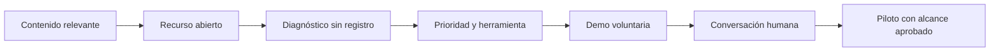

# Análisis · De la demo a una entrada comercial útil

**Corte:** 7 de noviembre de 2026. **Entrega:** investigación y propuesta; no implementación.

## Decisión recomendada

Crear `/descubre/` para responsables de salas de ventas de clubes vacacionales, con contenido abierto, diagnóstico y solicitud voluntaria. Conservar el acceso actual a la plataforma. Construir el mediahub como fuente editorial del embudo y el CMS como herramienta de publicación con permisos, no como otra biblioteca desconectada.

El valor de Sales Academy es llevar el método propio de cada sala a la preparación, práctica y acompañamiento del representante. La captación es una función de su sitio comercial; no debe convertirse en el posicionamiento del producto ni reducirlo a un chatbot o LMS genérico.

## Lo que está y lo que falta

| Evidencia | Lectura | Acción propuesta |
|---|---|---|
| El GET de `salesacademy.softvibes.art/` entrega un shell con `agenda.js` | La entrada actual es de producto/demo | Nueva ruta comercial legible sin JS y con enlace a la demo |
| App, tablero y sincronización documentados en noviembre | Hay prueba de producto para mostrar | Recorrido con datos de ejemplo, sin cifras de ventas ilustrativas |
| Identidad por selector y encabezado | El demo no proporciona login de producción | CMS separado con identidad real |
| Piloto tres salas EN REVISION en vcsAcademyMobile | Existe trabajo de definición, no evidencia de tres salas operativas | Explicar alcance, instancias aisladas y criterios por etapa |
| Presentaciones y simuladores anteriores | Hay materiales y estructura aprovechables | Reutilizar patrones sin publicar precios/proyecciones como actuales |
| Sin datos de tráfico o conversión leídos | No hay línea base comprobada para prometer crecimiento | Instrumentar y medir antes de fijar metas comerciales |

La auditoría mecánica `conversion_audit.py` sobre el HTML raíz descargado dio **23/100**. Es un indicador limitado del shell estático: no ejecuta el JavaScript, no ve la pantalla renderizada y no mide conversión. No significa que la app tenga calidad 23/100. Sí evidencia que esa respuesta HTML no contiene la propuesta y CTA de una landing comercial. Resultado guardado en `evidence/cro-shell.json`.

## Tres líneas que no deben confundirse

| Línea | Fuente | Estado y uso en la landing |
|---|---|---|
| Demo de tours de dos salas | `prototypes/smart-agenda-mockup/`, docs de 7 Nov | Mostrar como demo actual; no se probó de nuevo el API vivo en esta tarea |
| Piloto operativo de tres salas | `vcsAcademyMobile/work/stories/2026-11-06-piloto-3-salas.md` | EN REVISION, owner pendiente. Una instancia/SQLite/subdominio por sala. Entrenamiento; excluye tours/CRM, LLM externo y reporte consolidado |
| Proyección de expansión comercial | `investment/calculadora-semilla/PROYECCION_INGRESOS.md` | Escenario anterior de altas progresivas; no ventas ni ingresos realizados |

La nueva landing y su CMS no implementan el piloto ni modifican sus exclusiones. Un orden S1 → S2 → S3 es una recomendación de validación por etapas, no una fecha comprometida ni una aprobación ya recibida.

## Embudo invisible propuesto

“Invisible” describe una experiencia natural, no una finalidad comercial oculta. El recurso se entrega completo; el diagnóstico explica sus reglas; el contacto y las novedades tienen decisiones separadas. No se envía seguimiento por haber visitado o descargado algo.

## Prioridades de conversión

**Mejoras directas:** explicar destinatario y valor en el primer bloque; usar «Diagnosticar mi sala» como acción de descubrimiento; mostrar UI real etiquetada; explicar el resultado antes de pedir contacto; conservar acceso a la plataforma.

**Cambios de mayor impacto:** tres recursos completos enlazados por necesidad, diagnóstico de seis preguntas, recepción durable de solicitudes y CMS que mantiene una sola versión editorial publicada. Su resultado se juzgará por solicitudes atendidas y calificadas, no por clics aislados.

**Ideas de prueba:** mensaje de preparación frente a coordinación, recurso primero frente a diagnóstico primero, demo visible frente a demo posterior al resultado. Primero validar comprensión con usuarios; no hacer A/B con tráfico insuficiente ni declarar ganadores sin método y muestra definidos.

## Sistema de contenido

Tres pilares editoriales: coordinar la sala, practicar una habilidad y decidir con evidencia. Cada pieza tiene rol, necesidad, etapa del recorrido, fuente, responsable, estado y CTA contextual. La taxonomía organiza el contenido; no convierte una etiqueta en permiso de acceso a información privada.

Hay tres recursos originales completos en `landing-y-embudo.md`: preparación antes del tour, conversación de coaching y matriz de arranque en tres salas. El calendario propone doce piezas en cuatro semanas. Los cinco correos son borradores para una futura suscripción consentida, no una automatización instalada.

## Diseño y patrones elegidos

La base propia de academias es la opción principal. Negro/oro/blanco, variante marfil del producto, tipografía clara y protagonismo de la interfaz real. Mario aporta narrativa de formación, Close Factory y Softvibes Funnel aportan diagnóstico, Cisne Negro aporta gestión editorial y Los HDP aporta organización y procedencia de medios. Se reutilizan estructura y prácticas; no métodos, testimonios, contactos, cifras o imágenes de otros proyectos.

Se favorece lectura móvil, controles amplios, foco visible, contenido accesible sin animación y carga multimedia por elección. Los criterios de accesibilidad se verifican contra [WCAG 2.2](https://www.w3.org/WAI/WCAG22/quickref/); los de identidad, sesiones y cargas toman como referencia [OWASP](https://cheatsheetseries.owasp.org/cheatsheets/Authentication_Cheat_Sheet.html). Son criterios de aceptación, no certificaciones ya obtenidas.

## Operación y medición

- El editor prepara y guarda; el propietario revisa y publica. Borradores y originales son privados.
- El formulario informa recepción solo cuando el servidor confirma y evita duplicados por reintento.
- La bandeja requiere un responsable y proceso de atención antes de habilitarla públicamente.
- Las tasas distinguen visitas consentidas, diagnósticos y solicitudes recibidas. Cero denominador significa «Sin datos».
- Publicar y restaurar contenido nunca modifica usuarios, tours o captación posterior.
- Videos y transcripciones de trabajo requieren revisión de derechos y privacidad; estar en el repo no los convierte en publicables.

## Alcance de esta revisión

Se inspeccionaron fuentes locales y se descargó la portada pública por HTTPS. La herramienta web no pudo abrir el dominio y el navegador de la sesión no estaba disponible; curl sí permitió obtener el HTML. No hubo revisión visual en vivo, pruebas de carga, auditoría exhaustiva de seguridad ni pruebas sobre endpoints de producción. No se ejecutó el e2e de tours porque puede restablecer la semilla y escribir datos.

La propuesta está lista para decidir qué construir. La landing navegable, el CMS funcional, sus pruebas y la publicación siguen pendientes de la aprobación explícita de CP2.
